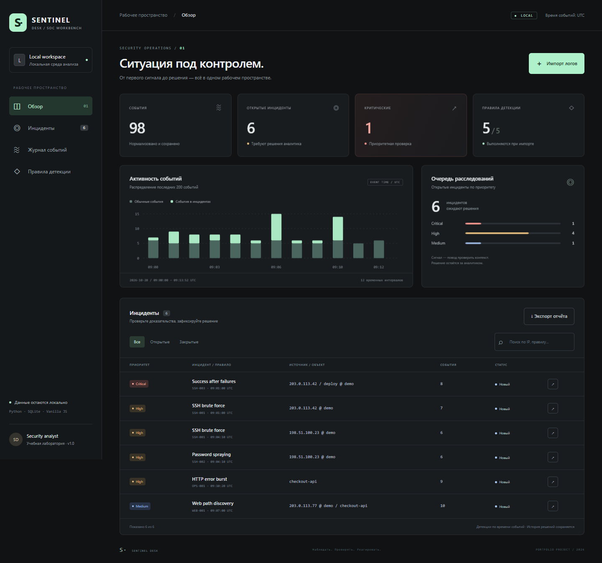

# Sentinel Desk

**Локальный рабочий стол аналитика SOC: от сырого лога до документированного решения.**

Python 3.11+ · SQLite · JavaScript · Без runtime-зависимостей · MIT

Sentinel Desk превращает SSH- и веб-логи в нормализованные события, проверяет их пятью правилами и собирает доказательства в карточках инцидентов. Аналитик изучает контекст, меняет статус, оставляет комментарий и выгружает отчёт.

Проект для портфолио в направлениях SOC, мониторинга и технической поддержки. Все демонстрационные события вымышлены; приложение не отправляет сетевые запросы к анализируемым системам.



## Запуск за минуту

Нужен **Python 3.11 или новее**. Клонируйте репозиторий и перейдите в его каталог, затем выполните:

```bash
python -m sentinel serve --demo
```

На Windows можно использовать `py -3` вместо `python`. Откройте **http://127.0.0.1:8765**. Остановка: `Ctrl+C`.

Устанавливать библиотеки и запускать внешние сервисы не требуется. Демо добавляет **98 событий и 6 инцидентов**; повторный запуск не создаёт копий. Данные и решения сохраняются в `data/sentinel.sqlite3`.

Для пустой рабочей области:

```bash
python -m sentinel --db data/my-investigation.sqlite3 serve
```

Флаг `--db` задаётся **до** команды. Флаги `--demo` и `--port` — после `serve`.

## Что можно показать работодателю

- **Импорт и нормализация:** SSH, nginx common/combined access log и JSONL; IPv4/IPv6, перевод времени в UTC, отчёт об ошибках по номерам строк.
- **Объяснимые детекции:** скользящие окна по времени событий, пороги и доказательства, независимость от порядка строк в файле.
- **Расследование:** фильтры и поиск, статусы, обязательный комментарий аналитика, сохранение истории при повторном импорте.
- **Работа с данными:** SQLite, атомарный импорт, идемпотентность, корреляция между импортами, экспорт Markdown.
- **Инженерная часть:** отделённые парсер, движок правил, хранилище и HTTP-адаптер; unit- и HTTP integration-тесты; CI на Windows и Linux.

### Демонстрация за 3 минуты

1. Запустите демо и откройте критический **Success after failures**.
2. Покажите 7 ошибок входа и следующий успешный вход пользователя `deploy` с `203.0.113.42`.
3. Переведите инцидент в «В работе», запишите, что именно нужно проверить. История появится сразу.
4. Откройте «Правила детекции» и объясните пороги и возможные ложные срабатывания.
5. Импортируйте `examples/demo.jsonl` с источником `demo`: новых событий не будет, решение сохранится.
6. Выгрузите отчёт кнопкой «Экспорт отчёта».

Подробнее: [архитектура и компромиссы](docs/architecture.md), [сценарий расследования](docs/investigation.md), [вопросы для собеседования](docs/interview.md).

## Правила

Границы временных окон включены. Анализ выполняется по **времени события**, а не времени загрузки.

| ID | Условие | Группировка | Приоритет |
| --- | --- | --- | --- |
| SSH-001 | ≥5 ошибок SSH-входа за 5 минут | Источник + IP | High |
| SSH-002 | Ошибки входа в ≥5 разных аккаунтов за 10 минут | Источник + IP | High |
| SSH-003 | Успешный вход после ≥5 ошибок за 10 минут | Источник + IP + пользователь | Critical |
| WEB-001 | 404 на ≥8 разных путей за 2 минуты | Источник + сервис + IP | Medium |
| OPS-001 | ≥5 ответов 5xx за 1 минуту | Сервис | High |

У SSH-003 каждый успешный вход сбрасывает предшествующую последовательность ошибок. У WEB-001 query string не делает путь уникальным. Один IP может дать несколько сигналов от разных правил: поэтому в демо 6 инцидентов при 5 правилах.

Одна карточка объединяет все срабатывания **одного правила для одного объекта** за время жизни базы. При появлении новых доказательств статус сохраняется, закрытые карточки автоматически не открываются. Это осознанное упрощение; для нового расследования используйте отдельную базу.

## Собственные логи

В интерфейсе нажмите «Импорт логов», выберите формат и задайте источник, например `prod-ssh-01`. Для SSH используйте отдельный источник на каждый хост. Загружайте файл UTF-8 либо вставляйте текст. HTTP-запрос ограничен 2 МиБ, включая JSON-обёртку; крупный лог можно разделить или импортировать через CLI.

```bash
python -m sentinel ingest examples/ssh.log --format ssh --source lab-ssh
python -m sentinel ingest examples/nginx-access.log --format nginx --source lab-web
python -m sentinel ingest examples/demo.jsonl --format jsonl --source demo
python -m sentinel export --output report.md
```

Некорректные строки пропускаются; корректные сохраняются в одной транзакции вместе с пересчётом инцидентов. Отчёт импорта показывает количество добавленных событий, дубликатов и ошибок, первые 100 причин отказа. CLI завершает обработанный импорт с кодом 0, даже если часть строк отклонена: проверяйте поле `rejected`.

**Идемпотентность:** SHA-256 от нормализованного события, включая источник. Идентичные записи одного источника считаются дублями; одинаковые записи с разными источниками — разными событиями. Доли секунды сохраняются до микросекунд. Если две реальные записи полностью совпадают по всем поддерживаемым полям, они также схлопнутся.

### SSH

```text
2026-10-20T09:01:00+00:00 host sshd[42]: Failed password for deploy from 203.0.113.42 port 2200 ssh2
2026-10-20T09:03:15+00:00 host sshd[42]: Accepted publickey for deploy from 203.0.113.42 port 2200 ssh2
```

Поддерживаются `Failed password`, `Accepted password`, `Accepted publickey`, в том числе `invalid user`. Нужна ISO 8601 дата с годом и часовым поясом. Формат `Oct 20 09:00:00` намеренно не принимается: год и зона не должны угадываться. Поля hostname, PID и port не сохраняются — идентификатор хоста задаётся источником.

### nginx

```text
192.0.2.10 - - [20/Oct/2026:09:00:00 +0000] "GET /api/orders HTTP/1.1" 200 512 "-" "demo-agent"
```

Используется первое поле IP; заголовкам `X-Forwarded-For` приложение не доверяет. Для nginx сервис по умолчанию `web`; отдельный сервис можно указать через JSONL. Парсер ожидает английское сокращение месяца, как в стандартном access log.

### JSONL

Один JSON-объект на строку:

```json
{"timestamp":"2026-10-20T09:00:00Z","kind":"http","ip":"192.0.2.10","service":"checkout-api","method":"GET","path":"/api/orders","status":200}
```

Обязательны `timestamp` с зоной, `kind`, `ip`; для HTTP — `status` (100–599), для `auth_failure`/`auth_success` — `user`. Неизвестные поля не сохраняются. Время без зоны отклоняется. Набор полей нормализованного события описан в [архитектуре](docs/architecture.md).

## Проверка

```bash
python -m unittest discover -s tests -v
python -m compileall -q sentinel
```

CI выполняет эти проверки на Linux/Windows с Python 3.11, 3.12 и 3.13. Файл workflow: [ci.yml](.github/workflows/ci.yml). Успешное выполнение CI на GitHub следует проверять во вкладке Actions после публикации.

Дополнительный браузерный smoke test описан в [tools/README.md](tools/README.md). Playwright используется только для разработки; приложению он не нужен.

## Область применения

Это **учебная локальная лаборатория** для небольших выгрузок логов. При каждом импорте правила пересчитываются по всем событиям в базе. Журнал и график показывают последние 200 событий; детекции используют всю базу. Фиксированных гарантий производительности нет.

Сервер слушает только `127.0.0.1`, проверяет Host и Origin у запросов на изменение, требует специальный заголовок и JSON, не разрешает CORS и не подгружает внешние ресурсы. Значения из логов выводятся через `textContent`; SQL использует параметры. Парсинг не исполняет содержимое логов.

В приложении нет аутентификации, ролей, неизменяемого аудита, ротации данных, live-tail и уведомлений. Доступ к процессам и файлам на том же компьютере означает доступ к базе. Не публикуйте этот сервер через туннель или reverse proxy. Для промышленного применения нужны отдельная модель доступа, ограничения ресурсов, потоковая обработка, миграции и политика хранения.

Не коммитьте реальные логи, персональные данные, ключи и рабочую базу. В репозитории предусмотрены только синтетические примеры; `data/` исключена из Git.

## English overview

Sentinel Desk is a local SOC investigation workbench built with the Python standard library, SQLite and vanilla JavaScript. It normalizes SSH/nginx/JSONL logs, evaluates five event-time detection rules, preserves analyst decisions and exports Markdown incident reports. It includes synthetic fixtures, a browser dashboard, unit/integration tests and a cross-platform GitHub Actions workflow. Run `python -m sentinel serve --demo` and open `http://127.0.0.1:8765`.

Author: **Динэр Трошкин / Diner Troshkin**. License: [MIT](LICENSE).
