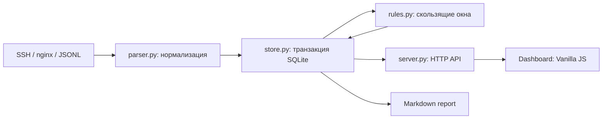

# Архитектура и принятые решения

## Разделение ответственности

| Модуль | Ответственность |
| --- | --- |
| `parser.py` | Валидация формата, UTC, IP, генерация идентификатора события |
| `rules.py` | Чистая детерминированная функция `detect(events)` |
| `store.py` | SQLite, импорт, инциденты, решения аналитика, отчёт |
| `server.py` | HTTP, валидация запросов и локальная граница доступа |
| `demo.py` | Детерминированный набор синтетических событий |
| `__main__.py` | CLI и жизненный цикл сервера |
| `static/` | Интерфейс без сборки и сетевых зависимостей |

## Модель события

`id`, `timestamp`, `kind`, `source`, `ip`, `user`, `service`, `path`, `method`, `status`.

- `timestamp`: ISO 8601 UTC, фиксированная точность 6 знаков. Это позволяет сортировать текстовое значение как время, без потери порядка долей секунды.
- `kind`: `auth_failure`, `auth_success`, `http`.
- `source`: идентификатор источника от оператора; для SSH должен соответствовать одному хосту.
- `service`: логическое имя сервиса. OPS-001 агрегирует ошибки этого имени через все источники.
- `id`: SHA-256 от отсортированного JSON нормализованных полей. Дубли одного источника исключаются ключом SQLite.

Сохраняются только поддерживаемые поля, исходная строка не сохраняется. Для полного расследования нужно вернуться к исходным логам. Веб-пути ограничены 2048 символами, пользователи/сервисы — 200, методы — 20; усечённые значения влияют на дедупликацию.

## Вычисление правил

1. События сортируются по времени, затем ID для воспроизводимого порядка при равных timestamp.
2. Для каждого правила формируются группы: IP и источник, пользователь или сервис.
3. Очередь `deque` хранит подходящие события временного окна; слева удаляются записи старше окна.
4. Проверяется порог общего количества либо количества уникальных пользователей/путей.
5. События окон, удовлетворяющих порогу, объединяются в доказательства одной карточки.

При одинаковом timestamp порядок между успехом и ошибкой SSH неизвестен: используется порядок ID, поэтому точно восстановить причинность нельзя. Для этого в реальном агенте понадобился бы порядковый номер записи или более точное время.

Карточка имеет устойчивый ID из правила и объекта группировки. Поздно пришедшие логи пересчитывают доказательства, не меняя ID. Статус и комментарии хранятся отдельно и не затираются пересчётом. Все эпизоды одного объекта в этой базе объединяются в одну карточку; автоматического переоткрытия нет.

## Транзакции и параллельные запросы

Для каждого обращения открывается отдельное соединение SQLite, а закрывается в `finally`. `BEGIN IMMEDIATE` резервирует запись до чтения и пересчёта правил. В одной транзакции сохраняются новые события, результаты детекции и статистика импорта. При исключении всё откатывается. WAL допускает чтение во время записи; timeout соединения — 30 секунд. Параллельные импорты сериализуются SQLite.

Схема намеренно простая: JSON события + индекс по времени; JSON доказательств; отдельная таблица истории. Полнотекстового поиска по всей базе нет: поиск в интерфейсе относится к карточкам инцидентов. База не мигрирует между будущими версиями автоматически.

## HTTP API

Для POST нужны `Content-Type: application/json` и `X-Sentinel-Request: 1`. Если присутствует `Origin`, он должен совпадать с `http://` + Host. Разрешённые Host: `127.0.0.1:<port>` и `localhost:<port>`. Ответы не разрешают CORS. Сервер привязан к IPv4 loopback.

| Метод | Путь | Назначение |
| --- | --- | --- |
| GET | `/api/health` | Проверка процесса HTTP |
| GET | `/api/state` | Счётчики, все карточки, последние 200 событий и 10 импортов |
| GET | `/api/rules` | Каталог порогов и рекомендаций |
| GET | `/api/incidents/<id>` | Карточка, все доказательства и история |
| GET | `/api/export` | Markdown-отчёт с решениями |
| POST | `/api/demo` | Идемпотентный импорт синтетического сценария |
| POST | `/api/import` | `{ "format": "ssh", "source": "host-a", "text": "..." }` |
| POST | `/api/incidents/<id>` | `{ "status": "investigating", "note": "..." }` |

Статусы: `new`, `investigating`, `resolved`, `false_positive`. Любой переход разрешён, но требует непустого комментария до 2000 символов. Это журнал решений одного локального пользователя, а не доказательный аудит с проверкой авторства.

Коды ошибок: 400 — неверные поля/JSON, 403 — Host/Origin/заголовок, 404 — нет ресурса, 413 — размер запроса, 415 — неверный Content-Type. Отклонённые строки логов описываются в успешном ответе импорта.

## Почему без ELK и Kafka

Задача проекта — воспроизводимое локальное расследование, которое проверяется одной командой. SQLite и стандартная библиотека делают критическую логику видимой и уменьшают требования к компьютеру проверяющего. Для больших потоков потребовались бы агент доставки, очередь, watermark для опоздавших событий, инкрементальные окна и отдельное хранилище поиска. Здесь эти компоненты отсутствуют.

## Ограничения защиты

Loopback, проверка Host и Origin, нестандартный заголовок, CSP и безопасная работа с DOM снижают риск обращения к локальному API из сторонней страницы. Они не заменяют аутентификацию. Приложение рассчитано на доверенного пользователя и небольшие доверенные файлы. Ограничение HTTP-запроса не ограничивает общий размер базы; лимита на число импортов и полноценной защиты от ресурсного истощения нет. Не используйте сервис как публичный endpoint.

## Следующие осмысленные улучшения

- Отдельные эпизоды инцидентов и переоткрытие при новом событии после решения.
- Потоковая обработка и watermark вместо полного пересчёта на каждом импорте.
- Схема версии базы, миграции и retention.
- Настраиваемые правила и allowlist, с тестами на подавление ложных сигналов.
- Аутентификация и журнал авторства, если появится многопользовательский режим.
